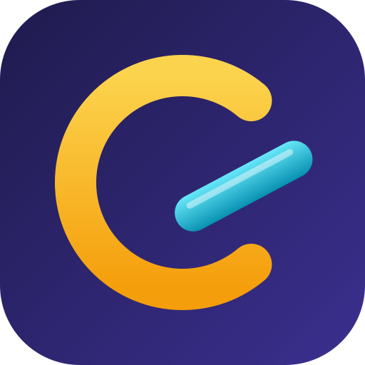

<p align="center"></p>

<h1 align="center">cestafet</h1>

**Your AI coding sessions, aware of each other.**

You run several Claude Code sessions at once — different terminals, different profiles
(`CLAUDE_CONFIG_DIR`), different repositories of the same product. cestafet lets them see each
other per project, and lets you tell one of them something that every other session then knows:

<p align="center"></p>

```
you (coordinator session):  tell the other sessions: testing has started, do not deploy to staging

claude:  → notify  "Testing has started. Do not deploy to staging until further notice."
         Delivered to 3 sessions.

another session, mid-task, before its next tool call:
         <cestafet-notice from="coordinator · claude-work" origin="user" …>
         Testing has started. Do not deploy to staging until further notice.
         </cestafet-notice>
         → ack  "ok, holding all staging deploys"
```

No CLI in daily use: you talk to Claude in plain language. The name is *estafet* — the relay
baton — with a **c** for Claude.

## How it works

- **Automatic registration.** A `SessionStart` hook registers every session with its profile,
  repository, branch and project before your first prompt.
- **Projects.** A project is a git repository (its normalized `origin` URL, so every clone,
  worktree and profile of it meets in one place). Several repositories can be grouped into one
  project — e.g. a backend, a UI and two workers — with `/cestafet:project <name>`. Outside git,
  a session joins the nearest parent directory that already has a session.
- **Delivery.** Notices are injected through hooks: at the next prompt (`UserPromptSubmit`) and —
  for sessions busy on their own — after their next tool call (`PostToolUse`), before they act again.
  Subagent tool calls never consume a notice; it waits for the main agent. A notice does **not**
  wake a session that is idle, waiting for its user: it sees the notice at its next message. Where
  your Claude Code client offers messaging between sessions, you can wake a session with it
  yourself; that starts a turn and interrupts the session, and the client's session names are not
  cestafet's labels.
- **Standing rules.** "No deploys to staging while testing" is kept as a rule: it stays in force
  until lifted ("testing finished, deploys are allowed again") or until it expires, reaches
  sessions that start later, and is listed to every session when it starts or compacts.
  A rule can carry narrow guard patterns (`*deploy* staging*`): before any session runs a matching
  Bash command, Claude Code asks you first, with the rule as the reason. cestafet never denies on
  its own.
- **Coordinator.** `/cestafet:coordinate` makes a session the project's coordinator and announces
  it to the others.
- **Local only.** One Go binary, one SQLite file (`~/.local/share/cestafet/bus.db`, mode 0600;
  `%USERPROFILE%\.cestafet\bus.db` on Windows), no daemon, no network. See [SECURITY.md](SECURITY.md).

## Install

### macOS and Linux

```bash
brew install --cask orkono/tap/cestafet
cestafet setup
```

The binaries are not yet signed or notarized by Apple; the Homebrew cask removes macOS's
quarantine flag after install so Gatekeeper does not block it.

### Windows (amd64, arm64)

Paste into PowerShell. It downloads the latest release for your processor, checks it against the
release's `checksums.txt`, puts `cestafet.exe` in `%USERPROFILE%\.local\bin` (where Claude Code's
own installer puts `claude.exe`) and adds that folder to your user `PATH`:

```powershell
& {
  $ErrorActionPreference = "Stop"; $ProgressPreference = "SilentlyContinue"
  $rel  = Invoke-RestMethod https://api.github.com/repos/orkono/cestafet/releases/latest
  $arch = if ($env:PROCESSOR_ARCHITECTURE -eq "ARM64") { "arm64" } else { "amd64" }
  $zip  = $rel.assets | Where-Object name -like "*_windows_$arch.zip"
  $sums = $rel.assets | Where-Object name -eq "checksums.txt"
  $tmp  = New-Item -ItemType Directory -Force "$env:TEMP\cestafet-install"
  Invoke-WebRequest $zip.browser_download_url -OutFile "$tmp\$($zip.name)"
  Invoke-WebRequest $sums.browser_download_url -OutFile "$tmp\checksums.txt"
  $want = (Select-String -Path "$tmp\checksums.txt" -SimpleMatch $zip.name).Line.Split(" ")[0]
  if ((Get-FileHash "$tmp\$($zip.name)" -Algorithm SHA256).Hash -ne $want) { throw "checksum mismatch" }
  Expand-Archive "$tmp\$($zip.name)" -DestinationPath $tmp -Force
  $bin = "$env:USERPROFILE\.local\bin"; New-Item -ItemType Directory -Force $bin | Out-Null
  # A running Claude session may hold the old cestafet.exe open: move it aside, then copy.
  Get-ChildItem "$bin\cestafet.old-*.exe" -ErrorAction SilentlyContinue | Remove-Item -ErrorAction SilentlyContinue
  if (Test-Path "$bin\cestafet.exe") { Rename-Item "$bin\cestafet.exe" "cestafet.old-$(Get-Date -Format yyyyMMddHHmmss).exe" }
  Copy-Item "$tmp\cestafet.exe" $bin
  $path = [Environment]::GetEnvironmentVariable("Path", "User")
  if (($path -split ";") -notcontains $bin) { [Environment]::SetEnvironmentVariable("Path", "$path;$bin", "User") }
  & "$bin\cestafet.exe" version
}
```

Then run `cestafet setup` (in a new terminal, so the updated `PATH` applies everywhere). Claude Code
runs the plugin's hooks through Git Bash, which Claude Code on Windows needs anyway. The executable
is not code-signed. To update later, paste the same block again; it works while Claude Code
sessions are open (the old executable is set aside and removed on the next update).

Notes for Windows:

- **Claude desktop app.** If you use Claude Code from the desktop app's Code tab, quit the app
  from the notification-area icon (**Quit**, not the window's ×) and start it again after
  installing: it reads `PATH` only when it starts. An MCP error `plugin:cestafet:cestafet …
  Connection closed` usually means `cestafet.exe` is not on the app's `PATH` yet. `cestafet setup`
  finds the app's own Claude Code when `claude` is not on your `PATH`.
- **Upgrading from 0.3.0.** cestafet's data moves from `AppData` to `%USERPROFILE%\.cestafet`
  (inside `AppData`, the desktop app's package kept a private copy that terminals and other
  editors could not see). The first session after the upgrade copies the newest old data,
  standing rules and named projects included; `cestafet doctor` shows what was moved and which
  old copies remain. Quit the desktop app and every Claude Code session before upgrading, so no
  0.3.0 process keeps writing to the old copy. `cestafet migrate --from <copy>` picks another copy
  by hand.
- **Data location.** `CESTAFET_DB` and `CESTAFET_PROJECTS` (user environment variables) move the
  database and the project file elsewhere; then no migration runs.
- **After the app restarts**, sessions that were open reappear in `/cestafet:who` once they get a
  message.
- **Native install only.** cestafet recognises a session by Claude Code's native `claude.exe` in
  its process chain; a Claude Code started through `node.exe` (an old npm install) is not found.

### With Go (any platform)

```bash
go install github.com/orkono/cestafet/cmd/cestafet@latest
cestafet setup
```

### After installing

`cestafet setup` finds every Claude Code profile on the machine (`~/.claude`, `~/.claude-*`, and
every `CLAUDE_CONFIG_DIR` in your shell rc files, PowerShell profiles, wrapper scripts and, on
Windows, your user environment variables), lets you choose, and
installs the plugin into each chosen profile with Claude Code's own `claude plugin` commands.
Restart open sessions afterwards. The binary must be on the `PATH` that Claude Code sees.

The first time Claude uses a cestafet tool it asks for permission; allow it, or add
`"mcp__plugin_cestafet_cestafet__*"` to `permissions.allow` in the profile's settings.

`cestafet doctor` shows which profiles have the plugin and how the current directory resolves.
`cestafet uninstall` removes it again.

## Use

| You say (any language) | What happens |
|---|---|
| `/cestafet:coordinate` or "coordinate this project" | this session becomes coordinator and is announced |
| "tell the other sessions: …" | `notify` — every other session of the project gets it |
| `/cestafet:who` or "who else is working on this?" | `sessions` — profile, repo, branch, status, summary |
| `/cestafet:project tonton` or "add this repo to the tonton project" | after checking the location (`whoami`), this repository joins project `tonton`; refused if other sessions would change project, unless you confirm |
| "did everyone get it?" | `notice_status` — delivered / acknowledged / replies |

Receiving sessions treat a notice as information: a user-origin notice (your own words, relayed)
is respected in their next steps; an agent-origin notice is weighed, never blindly obeyed.

## Debug CLI

```
cestafet sessions [project]   live sessions of a project
cestafet notices [project]    recent notices of a project
cestafet send <project> <text>  send a notice from the terminal (origin=agent)
cestafet doctor               binary and plugin versions, PATH, identity of this directory
```

## Status

v0.3.0. Claude Code only; macOS, Linux and Windows. Push delivery to idle sessions is planned next;
see [docs/roadmap.md](docs/roadmap.md). Design notes: [docs/design.md](docs/design.md),
[docs/v0.2-design.md](docs/v0.2-design.md).

## License

Apache-2.0
